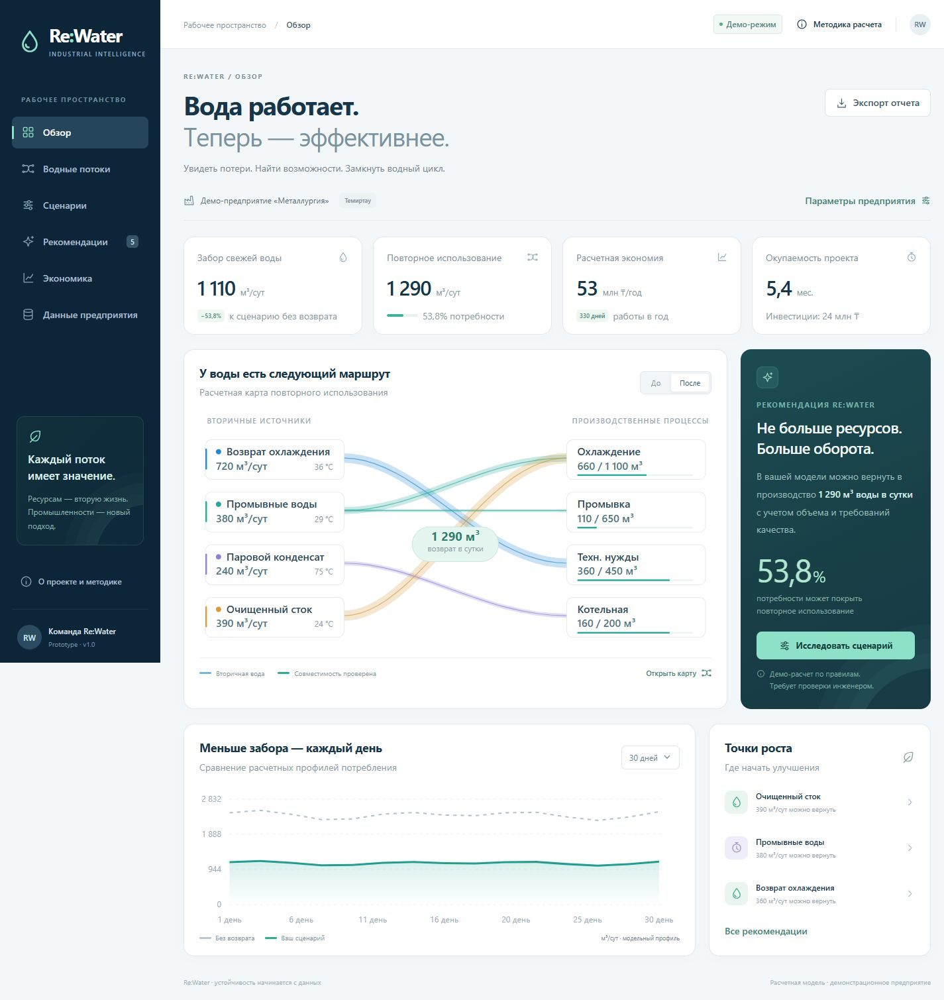

# Re:Water

Веб-прототип планирования повторного использования промышленной воды. Приложение сопоставляет источники и потребителей, проверяет ограничения качества и объема и рассчитывает экономический эффект.

## Открыть онлайн

[Запустить Re:Water в браузере](https://alphanskymavlikov.github.io/Re-Water/)

Скачивание, установка и API-ключи не требуются. Достаточно открыть ссылку на компьютере или телефоне.



## Запуск на компьютере

Требуется **Node.js 20 или новее**. Сторонних зависимостей нет, `npm install` не требуется.

```sh
npm start
```

Откройте **http://127.0.0.1:4173/**.

Можно запустить напрямую:

```sh
node serve.mjs
```

## Автономная версия

```sh
npm run build
```

Команда создает `standalone/index.html`: откройте этот файл браузером. CSS, данные и JavaScript встроены в HTML; для работы не требуются сервер, интернет или API-ключи. Сгенерированная папка исключена из Git.

## Возможности

- Обзор водного баланса и расчетных показателей.
- Интерактивная карта источников и производственных процессов.
- Распределение доступных потоков с учетом объемов, качества и затрат.
- Объяснение допустимости каждого маршрута по pH, TDS, температуре и нефтепродуктам.
- Сценарии нагрузки и водоподготовки, изменение тарифов и инвестиций.
- Расчет годовой операционной экономии и простой окупаемости.
- Сохранение и восстановление сценариев вместе с исходными данными.
- Редактирование источников, импорт и экспорт CSV.
- Экспорт текстового отчета с параметрами расчета.
- Интерфейс для компьютера и телефона.

## Структура

```text
dist/
  index.html        HTML-оболочка
  styles.css        Интерфейс и адаптация
  model.mjs         Данные, ограничения, оптимизатор и проверка CSV
  app.mjs           Страницы, события и локальное сохранение
docs/
  preview.jpg       Снимок интерфейса
serve.mjs           Локальный статический сервер
build-offline.mjs   Сборка автономного HTML
test-model.mjs      Тесты расчетной модели
package.json        Команды запуска и проверки
```

В этой версии `dist/` содержит исходные статические файлы приложения и хранится в репозитории. Для обычного запуска сборка не нужна.

## Публикация

GitHub Pages публикует содержимое `dist/`. Файл `.github/workflows/static.yml` запускает публикацию при изменении приложения в ветке `main` или вручную через Actions. Адрес сайта остается прежним при обновлениях.

## Проверки

```sh
npm test
npm run check
```

Тесты проверяют водный баланс, ограничения источников и потребителей, совместимость качества, расчет экономии, сценарии без выгодных маршрутов, перераспределение потоков и обработку CSV.

## Импорт CSV

На странице «Данные предприятия» скачайте шаблон, измените значения и загрузите файл обратно. Импорт заменяет список источников; потребители остаются демонстрационными.

```csv
id;name;volume;ph;tds;temp;oil;transferCost;area
cooling;Возврат охлаждения;720;7.4;580;36;1.2;6;Плавильный цех
```

- `id` — уникальный идентификатор.
- `name` — название источника.
- `volume` — доступный объем, м³/сут.
- `ph` — pH, от 0 до 14.
- `tds` — минерализация, мг/л.
- `temp` — температура, °C.
- `oil` — нефтепродукты, мг/л.
- `transferCost` — стоимость перенаправления, ₸/м³; необязательное поле.
- `area` — участок; необязательное поле.

При разделителе `;` десятичные значения допускают точку или запятую. Нельзя использовать разделитель или перенос строки внутри названия. Файл — UTF-8, до 200 КБ, от 1 до 30 источников.

## Метод расчета

Используется задача минимальной стоимости потока с остаточной сетью. Для каждого допустимого маршрута учитываются предотвращенные расходы на свежую воду и водоотведение, а также стоимость перенаправления и подготовки. Маршруты без положительной операционной экономии исключаются. Объем ограничен доступностью источника и допустимой долей вторичной воды у потребителя.

Годовая операционная экономия — суточная экономия, умноженная на количество рабочих дней. Простая окупаемость в месяцах — инвестиции, разделенные на годовую экономию и умноженные на 12. При отсутствии экономии окупаемость не определяется.

## Границы прототипа

- «Металлургия» — вымышленное демонстрационное предприятие.
- Параметры качества и тарифы — учебные допущения, не нормативы и не результаты производственных измерений.
- Рекомендации формируются локальным оптимизатором. Живая нейросеть не подключена.
- График потребления синтетический: это иллюстрация, не обученный прогноз.
- Водоподготовка моделируется условно: TDS −35%, нефтепродукты −90%, температура не выше 27 °C, стоимость 22 ₸/м³. Эти значения не описывают реальную установку.
- Нет расчета гидравлики, динамики накопителей, потерь очистки, налогов, дисконтирования и финансирования.
- Нет подключения к оборудованию и автоматического управления установками.
- Пользовательские рабочие данные сохраняются в `localStorage` браузера и не отправляются на сервер.

Перед практическим внедрением необходимы обследование, лабораторный анализ и проверка инженером. Подключение ИИ, реальных приборов учета и серверного хранения — отдельные этапы развития.
